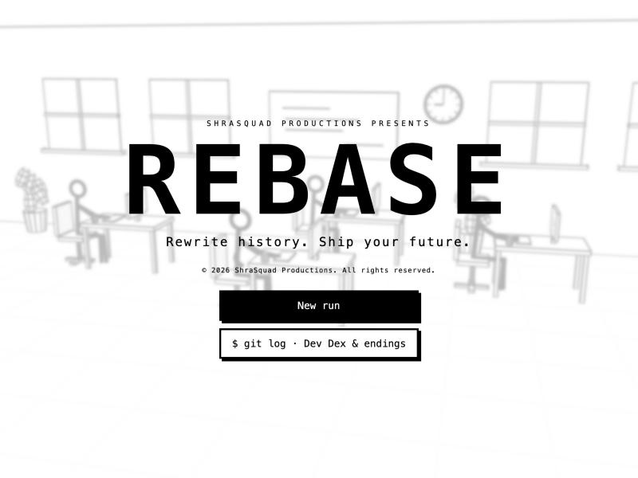
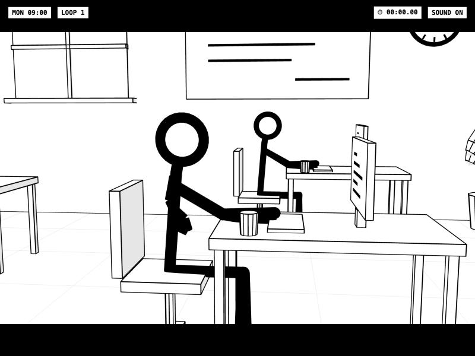
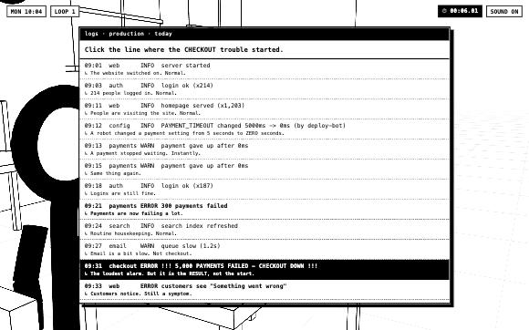
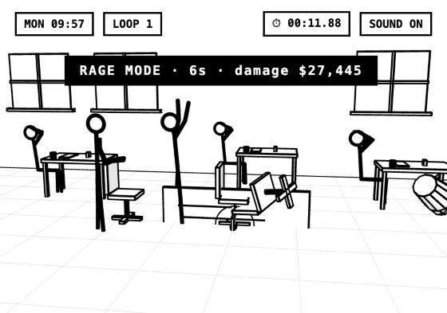
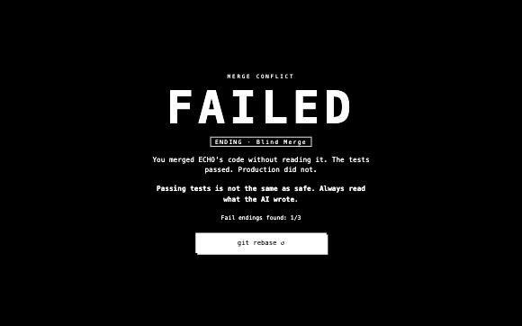

<p align="center">
  
</p>

<h1 align="center">REBASE</h1>

<p align="center">
  <b>Rewrite history. Ship your future.</b><br>
  A black &amp; white stickman time-loop game about being a software engineer in the age of AI.<br>
  <sub>© 2026 ShraSquad Productions</sub>
</p>

<p align="center">
  
  
  
  
</p>

---

## The story

You are a junior software engineer in 2026, the year AI writes half the code. Enter your own name when you start, or play as **Stix**.

It's Monday, 09:00. At 09:40 checkout goes down, customers can't pay, and your manager wants it fixed before the 17:00 "restructuring" meeting. Your AI pair-programmer **ECHO** is eager to help. Mostly helpful. Occasionally makes things up.

Fail the day and ECHO rewinds time to 09:00: a **REBASE**. You keep everything you learned. The day remembers too.

> The full arc follows Stix from junior engineer to founder across six chapters. Chapter 1, *The Layoff*, is playable now.

## Screenshots

| | |
|---|---|
|  |  |
| **The office.** Paper-white world, ink outlines, cinematic camera. | **Read the logs.** Find where the trouble *started*, not the loudest error. |
|  |  |
| **Rage mode.** Flip the desk. Launch the server rack. Count the damage. | **Fail endings.** Every failure is collectible, and teaches something. |

## How to play

| Input | Action |
|---|---|
| Click / `Space` / `Enter` | Continue dialogue |
| `1`–`5` or click | Pick a choice |
| `Space` or tap | Time the deploy (hit the needle inside the box) |
| Click objects / mash `Space` | Smash things in rage mode |
| `S` or **SKIP ▸▸** | Fast-forward a cutscene (great on retries) |
| `Esc` or **II PAUSE** | Pause: resume, settings, quit to title. The clock stops |
| `M` | Sound on/off |

### Settings

Available from the title screen and the pause menu, and saved in your browser:

- **Story mode.** No visible timer, no 17:00 fail, an easier deploy. Runs aren't ranked.
- **Reduce motion & flashes.** Turns off screen shake, white flashes and color inversion.
- **Text speed.** Normal, fast or instant.
- **Sound.** On or off.
- **Name.** What everyone in the office calls you.

### Rules of the loop

- **↺ REBASE.** Fail and the day restarts at 09:00. Clues you found carry over and unlock shortcuts.
- **⏱ The clock only runs while you act.** Reading dialogue and learning is free. Choices, puzzles and the deploy are timed.
- **⚡ Every retry is harder.** The root cause moves in the logs, red herrings appear, ECHO's mistakes get subtler, the deploy window shrinks and the day clock speeds up. Clues beat difficulty: know the cause and you can skip straight to the fix.
- **✎ No coding knowledge needed.** ECHO explains every tech term in plain English the first time it appears, and each one unlocks a card in the **Dev Dex**. Every puzzle has an optional *Explain simply* hint, and after three misses ECHO helps out.

### Chapter 1 paths

| Choice | Where it leads |
|---|---|
| Read the logs myself | Log puzzle: find the config change that started it all |
| Ask ECHO to fix it | ECHO writes a fix. Merge it blindly, or review it and catch the hallucinated line |
| Grab a coffee first | A fail ending you will not be proud of |
| Flip the desk. I'm DONE. | Rage mode: 12 seconds of smashing, then HR |
| *(after a clue)* I already know the cause | The speedrun route |

**Fail endings:** Coffee Break · Blind Merge · Rage Quit · 17:00. Find them all in `$ git log` on the title screen.

### Scoring

Your rank comes from **time + 30 s per loop reset + 20 s per hint**:

| Rank | Score |
|---|---|
| **S** | ≤ 90 s |
| **A** | ≤ 150 s |
| **B** | ≤ 240 s |
| **C** | ≤ 360 s |
| **D** | above that |

Your best run is saved in the browser. **Copy result to share** gives you a Wordle-style summary to paste to friends.

## Run it locally

No build step and nothing to install. Serve the folder with any static server:

```bash
python3 -m http.server 8770
```

Then open **http://localhost:8770** in Chrome, Edge, Firefox or Safari. Three.js is bundled in `vendor/`, so it works offline.

> Opening `index.html` straight from disk (`file://`) won't work. Browsers block ES modules from local files, so use a server.

## Tech stack

| Layer | Tool | Role |
|---|---|---|
| Rendering | [Three.js](https://threejs.org) 0.186.1 (bundled in `vendor/`, loaded by an import map) | 2.5D world, cinematic camera, toon shading |
| Ink outlines | `LineSegments2` + `EdgesGeometry` (Three.js add-on) | Thick black edges on every prop |
| Logic | Vanilla JavaScript, ES modules | Game loop, story, physics |
| UI | HTML + CSS overlay | Dialogue, choices, puzzles, HUD, cards |
| Sound | Web Audio API | Every blip, alarm and rewind is synthesized. No audio files |
| Saves | `localStorage` | Dev Dex, fail endings, best rank |

### How it works

- **Game loop** (`main.js`): every frame it updates tweens, timers, stickmen and the world, then renders. Slow-mo is a `timeScale` multiplier on game time.
- **Stickman** (`stickman.js`): a pose is 11 numbers (joint angles, lean, hip height). Forward kinematics turns them into joint positions, and each bone is a black cylinder. Poses blend with easing, with breathing, typing and walk cycles layered on top.
- **Camera director** (`anim.js`): named shots (`wide`, `stix`, `monitor`, `boss`) that the camera glides between, plus screen shake.
- **Story as a script** (`story.js`): the chapter reads like a screenplay of `await` steps. A failure `throw`s, the runner catches it, plays the fail ending and REBASE, and replays the day with memory intact.
- **Rage physics** (`world.js`): smashable props get velocity, spin, gravity and floor bounces. REBASE tweens every piece back to its saved home.

## Project structure

```
rebase/
├── index.html        stage canvas, overlays, Three.js import map
├── style.css         strict black & white theme
├── src/
│   ├── main.js       renderer, scene, cast, game loop, saves
│   ├── anim.js       easing, tweens, camera director
│   ├── world.js      ink-outlined office, smashable props, physics
│   ├── stickman.js   rig, poses, walk cycle, scarf
│   ├── ui.js         dialogue, choices, panels, QTE, HUD, sound
│   └── story.js      Chapter 1, loop logic, Dev Dex, endings, scoring
├── vendor/three/     Three.js 0.186.1 (MIT), bundled for offline play
├── docs/             screenshots
├── CREDITS.md
└── LICENSE
```

## Roadmap

- [x] **Chapter 1: The Layoff.** Production outage, log and AI-review puzzles, deploy, rage mode
- [ ] **Chapter 2: The Interview.** Prompt-builder and system-design puzzles
- [ ] **Chapter 3: The Side Project.** AI credit budget, user interviews
- [ ] **Chapter 4: Demo Day.** Investor profiling, live-demo crash
- [ ] **Chapter 5: The 3 AM Outage.** Incident triage, the ethical shortcut
- [ ] **Chapter 6: The Offer.** ECHO's secret, four endings
- [ ] Daily Loop: one date-seeded puzzle a day, the same for everyone
- [ ] Story mode: relaxed timing for players who are here for the plot

## Credits & license

Story, code, animation and sound are original work by **ShraSquad Productions**. Third-party libraries are listed in [`CREDITS.md`](CREDITS.md).

© 2026 ShraSquad Productions. All rights reserved. See [`LICENSE`](LICENSE).
